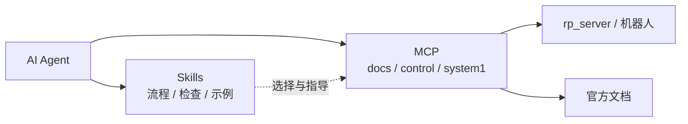

<div align="center">

# RoboParty Skills

**让 AI 真正会操作 RoboParty 人形机器人。**

面向 **Roboto Origin / 萝博头原型机** 与 **RP1** 的开源 Agent Skills 集合：烧录、走线、标定、调试、训练、部署与安全操作，全部按官方流程整理。

[中文](README.md) | [English](README_EN.md)

[](LICENSE)
[](https://github.com/Roboparty/roboparty_skills/releases)
[](https://roboparty.com/roboto_origin/doc)
[](https://github.com/Roboparty/roboparty_mcp)
[](https://github.com/Roboparty/roboparty_skills/pulls)

</div>

---

## 为什么是 Skills？

大模型不缺“机器人知识”，缺的是**可执行、可复用、带安全边界的操作流程**。

| 能力 | 说明 |
|---|---|
| 可移植 | 每个技能就是一个 `SKILL.md`，可放入 Claude Code、Cursor、Codex 等客户端 |
| 可组合 | 从入门、接线、标定到部署，按任务串联，不必把整本手册塞进上下文 |
| 安全优先 | 明确只读边界、使能条件、急停与人工确认点 |
| 与 MCP 解耦 | Skills 负责“怎么做”，MCP 负责“真正执行” |

## Skills 与 MCP 的分工



- **Skills（本仓库）**：操作流程、安全检查、工具选择、排障思路和示例。
- **MCP（[roboparty_mcp](https://github.com/Roboparty/roboparty_mcp)）**：可执行工具，例如 `docs_*`、`control_*`、`system1_*`。

Skills 不包含控制代码，也不携带机器人 token；控制授权始终留在 MCP 与 rp_server 层。

## 快速开始

### 复制技能

```bash
git clone https://github.com/Roboparty/roboparty_skills.git

# Claude Code
cp -R roboparty_skills/skills/* ~/.claude/skills/

# Cursor
# cp -R roboparty_skills/skills/* ~/.cursor/skills/

# Codex
# cp -R roboparty_skills/skills/* ~/.codex/skills/
```

只安装单个技能时，复制对应目录即可：

```bash
cp -R roboparty_skills/skills/rpo-introduction ~/.claude/skills/
```

### 作为插件使用

把本仓库添加为本地插件市场。清单位于：

```text
.claude-plugin/marketplace.json
plugins/roboparty-skills/
```

插件中的技能由 `scripts/sync-plugin.mjs` 从 `skills/` 同步生成。

## 一次典型工作流

```text
rpo-introduction
      ↓
rpo-safety-guide
      ↓
rpo-wiring / rpo-assembly / rpo-zero-calibration
      ↓
rpo-burn-flash / rpo-stm32-firmware / rpo-embedded-software
      ↓
rpo-deploy-sdk / rpo-motion-control / rpo-navigation
      ↓
rpo-qa / rpo-after-sales
```

RP1 开发链路则从 `rp1-overview` 开始，按需进入 `rp1-main-controller`、`rp1-bsp-firmware`、`rp1-canfd-bus`、`rp1-rl-training` 等技能。

## 技能地图

共 **42 个技能**，覆盖从入门到维护的完整链路。

| 分类 | 技能 |
|---|---|
| RP1 嵌入式固件 | `rp1-main-controller`, `rp1-bsp-firmware` |
| RP1 总览 | `rp1-overview`, `rp1-safety`, `rp1-prd` |
| RP1 机械结构 | `rp1-mechanism` |
| RP1 模型部署 | `rp1-description`, `rp1-deploy`, `rp1-dexhand`, `rp1-navigation`, `rp1-joystick-teleop` |
| RP1 测试与开源 | `rp1-test`, `rp1-hardware-open` |
| RP1 硬件电气 | `rp1-hardware-architecture`, `rp1-electrical-power`, `rp1-canfd-bus`, `rp1-motor` |
| RP1 算法训练 | `rp1-rl-training`, `rp1-mimic-dance`, `rp1-bfm` |
| 入门与安全 | `rpo-introduction`, `rpo-safety-guide` |
| 嵌入式软件 | `rpo-embedded-software` |
| 开源与社区 | `rpo-community-contributing`, `rpo-license` |
| 文档与写作 | `article-writer`, `roboparty-docs` |
| 服务与支持 | `rpo-after-sales`, `rpo-qa` |
| 烧录与固件 | `rpo-burn-flash`, `rpo-stm32-firmware` |
| 硬件与电气 | `rpo-hardware-electrical`, `rpo-motor-debug`, `rpo-industrial-design`, `rpo-bom-parts` |
| 算法与软件 | `rpo-motion-control`, `rpo-rl-training`, `rpo-navigation` |
| 装配与标定 | `rpo-zero-calibration`, `rpo-wiring`, `rpo-assembly` |
| 部署与 SDK | `rpo-deploy-sdk` |

完整索引见 [`skills/skill-index.json`](skills/skill-index.json)，技能关系见 [`docs/SKILL-MAP.md`](docs/SKILL-MAP.md)。

## 仓库结构

```text
.
├── skills/                 # 技能源文件：每个目录一个 SKILL.md
├── plugins/                # 插件市场镜像
├── .claude-plugin/         # Claude 插件清单
├── docs/                   # 技能地图与外部链接
├── scripts/
│   ├── sync-plugin.mjs     # skills -> plugins 同步
│   └── validate-release.mjs
├── skills.sh.json          # 技能注册表
└── README.md
```

## 安全边界

- 技能是**操作指南**，不会自行使能电机、刷写固件或发送运动指令。
- 涉及硬件动作时，必须按技能中的前提检查执行：可靠支撑、急停可达、电源限流、总线状态和有效反馈。
- 控制类动作由 MCP 调用 rp_server 完成；Skills 不保存 token，也不绕过 lease / stop / 权限校验。
- `set_zero.py`、标定、清错、回零等写操作必须获得明确授权后再执行。

## 开发与贡献

```bash
# 1. 新增技能
mkdir -p skills/my-skill
$EDITOR skills/my-skill/SKILL.md

# 2. 注册到 skills.sh.json 后同步插件
node scripts/sync-plugin.mjs

# 3. 发布前自检
node scripts/validate-release.mjs
```

提交前请确保：

- `SKILL.md` 的 frontmatter 完整，触发条件明确。
- 命令、路径、版本号和引脚定义已对照官方文档。
- 不包含 token、私钥、设备序列号等敏感信息。
- `node scripts/validate-release.mjs` 输出 `RELEASE CHECK PASSED`。

## 生态

- 官网：<https://roboparty.com>
- 文档中心：<https://roboparty.com/roboto_origin/doc>
- MCP 运行时：[Roboparty/roboparty_mcp](https://github.com/Roboparty/roboparty_mcp)
- 问题与建议：[Issues](https://github.com/Roboparty/roboparty_skills/issues)

## License

GPL-3.0-only，见 [LICENSE](LICENSE)。技能引用的官方文档、飞书资料和第三方仓库仍受各自版权与许可约束。
