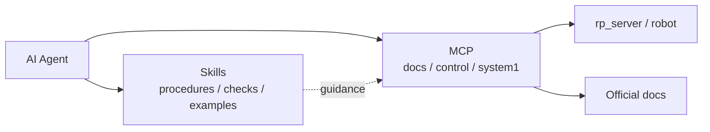

<div align="center">

# RoboParty Skills

**Agent Skills that teach AI how to operate RoboParty humanoid robots.**

An open-source skill collection for **Roboto Origin** and **RP1**: flashing, wiring, calibration, debugging, training, deployment, and safe operation, following the official procedures.

[中文](README.md) | English

[](LICENSE)
[](https://github.com/Roboparty/roboparty_skills/releases)
[](https://roboparty.com/roboto_origin/doc)
[](https://github.com/Roboparty/roboparty_mcp)
[](https://github.com/Roboparty/roboparty_skills/pulls)

</div>

---

## Why skills?

Large models do not lack robotics knowledge. They lack **executable, reusable procedures with safety boundaries**.

| Capability | What it means |
|---|---|
| Portable | Every skill is a `SKILL.md` that works with Claude Code, Cursor, Codex, and similar clients |
| Composable | Chain introduction, wiring, calibration, and deployment without loading the whole manual |
| Safety first | Explicit read-only boundaries, enable preconditions, E-stop checks, and human confirmation points |
| Decoupled from MCP | Skills describe **how**; MCP performs the actual tool calls |

## Skills and MCP



- **Skills (this repository)**: procedures, safety checks, tool selection, troubleshooting, and examples.
- **MCP ([roboparty_mcp](https://github.com/Roboparty/roboparty_mcp))**: executable tools such as `docs_*`, `control_*`, and `system1_*`.

Skills contain no control code and no robot tokens. Authorization stays in MCP and rp_server.

## Quick start

### Copy skills

```bash
git clone https://github.com/Roboparty/roboparty_skills.git

# Claude Code
cp -R roboparty_skills/skills/* ~/.claude/skills/

# Cursor
# cp -R roboparty_skills/skills/* ~/.cursor/skills/

# Codex
# cp -R roboparty_skills/skills/* ~/.codex/skills/
```

Install a single skill:

```bash
cp -R roboparty_skills/skills/rpo-introduction ~/.claude/skills/
```

### Use as a plugin

Add this repository as a local plugin marketplace. Manifests live in:

```text
.claude-plugin/marketplace.json
plugins/roboparty-skills/
```

Plugin skills are mirrored from `skills/` by `scripts/sync-plugin.mjs`.

## A typical workflow

```text
rpo-introduction
      ↓
rpo-safety-guide
      ↓
rpo-wiring / rpo-assembly / rpo-zero-calibration
      ↓
rpo-burn-flash / rpo-stm32-firmware / rpo-embedded-software
      ↓
rpo-deploy-sdk / rpo-motion-control / rpo-navigation
      ↓
rpo-qa / rpo-after-sales
```

For RP1 development, start with `rp1-overview`, then move into `rp1-main-controller`, `rp1-bsp-firmware`, `rp1-canfd-bus`, `rp1-rl-training`, and related skills.

## Skill map

**42 skills** covering the full lifecycle.

| Category | Skills |
|---|---|
| RP1 embedded firmware | `rp1-main-controller`, `rp1-bsp-firmware` |
| RP1 overview | `rp1-overview`, `rp1-safety`, `rp1-prd` |
| RP1 mechanism | `rp1-mechanism` |
| RP1 model deployment | `rp1-description`, `rp1-deploy`, `rp1-dexhand`, `rp1-navigation`, `rp1-joystick-teleop` |
| RP1 testing and open hardware | `rp1-test`, `rp1-hardware-open` |
| RP1 hardware and power | `rp1-hardware-architecture`, `rp1-electrical-power`, `rp1-canfd-bus`, `rp1-motor` |
| RP1 training | `rp1-rl-training`, `rp1-mimic-dance`, `rp1-bfm` |
| Introduction and safety | `rpo-introduction`, `rpo-safety-guide` |
| Embedded software | `rpo-embedded-software` |
| Open source and community | `rpo-community-contributing`, `rpo-license` |
| Docs and writing | `article-writer`, `roboparty-docs` |
| Service and support | `rpo-after-sales`, `rpo-qa` |
| Flashing and firmware | `rpo-burn-flash`, `rpo-stm32-firmware` |
| Hardware and electrical | `rpo-hardware-electrical`, `rpo-motor-debug`, `rpo-industrial-design`, `rpo-bom-parts` |
| Algorithms and software | `rpo-motion-control`, `rpo-rl-training`, `rpo-navigation` |
| Assembly and calibration | `rpo-zero-calibration`, `rpo-wiring`, `rpo-assembly` |
| Deployment and SDK | `rpo-deploy-sdk` |

See [`skills/skill-index.json`](skills/skill-index.json) for the full index and [`docs/SKILL-MAP.md`](docs/SKILL-MAP.md) for relationships.

## Repository layout

```text
.
├── skills/                 # One SKILL.md per skill
├── plugins/                # Plugin marketplace mirror
├── .claude-plugin/         # Claude plugin manifest
├── docs/                   # Skill map and external links
├── scripts/
│   ├── sync-plugin.mjs     # skills -> plugins
│   └── validate-release.mjs
├── skills.sh.json          # Skill registry
└── README.md
```

## Safety boundaries

- Skills are **instructions**, not an autonomous controller. They do not enable motors, flash firmware, or send motion commands by themselves.
- Hardware procedures require the documented preconditions: stable support, reachable E-stop, current-limited supply, healthy bus, and valid feedback.
- Control actions are executed by MCP through rp_server. Skills never store tokens and never bypass lease, stop, or permission checks.
- `set_zero.py`, calibration, error clearing, and homing require explicit authorization.

## Contributing

```bash
# 1. Add a skill
mkdir -p skills/my-skill
$EDITOR skills/my-skill/SKILL.md

# 2. Register it, then sync the plugin mirror
node scripts/sync-plugin.mjs

# 3. Validate before opening a PR
node scripts/validate-release.mjs
```

Before submitting:

- Complete the `SKILL.md` frontmatter and trigger conditions.
- Verify commands, paths, versions, and pin definitions against official docs.
- Never include tokens, private keys, or device serial numbers.
- Make `node scripts/validate-release.mjs` print `RELEASE CHECK PASSED`.

## Ecosystem

- Website: <https://roboparty.com>
- Documentation: <https://roboparty.com/roboto_origin/doc>
- MCP runtime: [Roboparty/roboparty_mcp](https://github.com/Roboparty/roboparty_mcp)
- Issues: [GitHub Issues](https://github.com/Roboparty/roboparty_skills/issues)

## License

GPL-3.0-only, see [LICENSE](LICENSE). Referenced official docs, Feishu documents, and third-party repositories keep their own terms.
